# Smart Waste System (SWS)

SWS is a local prototype for automatic waste sorting and bin monitoring. An
ESP32-CAM detects an inlet arrival and retains a JPEG. A separate ESP32 DevKit
asks the FastAPI backend to classify that image through Roboflow, then controls
the chute and flap for accepted categories. The backend records classification
and physical outcomes separately. MQTT carries board heartbeats and fill readings;
the React dashboard shows bins, collection tasks and records.



[Editable diagram source](docs/assets/system-architecture.mmd)

## Start with the relevant folder

| Folder | Guide | Agent instructions |
| --- | --- | --- |
| [backend](backend/) | [API, worker, database and tests](backend/README.md) | [AGENTS](backend/AGENTS.md) |
| [frontend](frontend/) | [Dashboard and UI development](frontend/README.md) | [AGENTS](frontend/AGENTS.md) |
| [firmware](firmware/) | [Active board sources, builds and wiring](firmware/README.md) | [AGENTS](firmware/AGENTS.md) |
| [scripts](scripts/) | [Setup, automatic operation and diagnostics](scripts/README.md) | [AGENTS](scripts/AGENTS.md) |
| [infra](infra/) | [Broker accounts and topic permissions](infra/README.md) | [AGENTS](infra/AGENTS.md) |
| [simulator](simulator/) | [Explicit synthetic demo data](simulator/README.md) | [AGENTS](simulator/AGENTS.md) |
| [docs](docs/) | [Architecture, contracts and hardware history](docs/README.md) | [AGENTS](docs/AGENTS.md) |
| [.github](.github/) | [CI checks](docs/ci.md) | [AGENTS](.github/AGENTS.md) |

Agents should read [root instructions](AGENTS.md) before the instructions for
folders they change. Commands below run from the repository root.

## Run the software demo

Install Docker with Compose, uv, and Nub 0.9.0. On a fresh checkout, copy
[.env.example](.env.example) to `.env`; preserve an existing configured `.env`.

```sh
docker compose --profile demo up --build -d --wait
```

Open <http://localhost:5173>; API documentation is at
<http://localhost:8000/docs>. The default provider is mock and the simulator
labels measurements as synthetic. The demo does not drive physical boards.
Use an isolated environment for the demo; do not start its simulator against an
existing hardware deployment. Docker may require `sudo` on your machine. See [simulator setup](simulator/README.md).

## Develop the dashboard against the hardware backend

For the existing private hardware configuration:

```sh
sudo docker compose start db broker api worker
sudo docker compose \
  --env-file .env --env-file .env.hardware --env-file .env.roboflow \
  -f compose.yaml -f compose.hardware.yaml -f compose.roboflow.yaml \
  -f compose.frontend-dev.yaml up -d --build --no-deps --wait frontend
```

Frontend source reloads automatically. Rebuild after dependency changes.
The frontend uses Vite, React, TypeScript, TanStack Router/Query, shadcn/ui and
Tailwind. [Frontend guide](frontend/README.md) covers local development and checks.

## Configure and operate physical boards

The committed environment templates are:

- [.env.example](.env.example): API/database/provider and worker settings.
- [.env.hardware.example](.env.hardware.example): LAN binding and device MQTT accounts.
- [.env.roboflow.example](.env.roboflow.example): live workflow overrides; the API key stays in `.env`.

Generate matching Wi-Fi/MQTT board headers with `scripts/configure-hardware.py`,
create the private camera OTA credential with `scripts/camera-control.py configure`,
and generate the DevKit control header with `scripts/configure-station.py`.
Follow [firmware setup](firmware/README.md) before uploading. Private `.env*` and
`*.local.h` files are ignored; examples and lockfiles are committed.

After firmware and services are configured:

```sh
./scripts/test-full-sequence.sh       # One autonomous item; same as station-auto once
./scripts/station-auto.sh on          # Continuous mode, saved on the DevKit
./scripts/station-auto.sh off         # Disable new arrivals
./scripts/station-auto.sh stop        # Disable auto and release servo PWM
./scripts/station-auto.sh status
```

Arming commands check MQTT accounts and repair them if needed before proceeding;
sudo may prompt for Docker access. The full-sequence script uses the firmware
controller, not a separate per-item laptop bridge. Details are in
[scripts](scripts/README.md) and [station operation](docs/autonomous-station.md).

The current mechanism has two positions: recyclable at home, e-waste at the side.
Unknown/non-recyclable decisions do not actuate. One compartment has a physical
fill sensor; two remain explicitly simulated. Fill calibration is provisional.
Fast drop detection, exposure timing and recognition accuracy need acceptance
checks on the assembled mount; successful upload/compilation alone does not prove
an item was imaged correctly or sorted. Historical validation notes are indexed
in [docs](docs/README.md).

## Verify changes

```sh
uv run --directory backend ruff check app tests migrations ../scripts ../simulator
uv run --directory backend pytest -q
nub --cwd frontend run lint
nub --cwd frontend run test
nub --cwd frontend run build
./scripts/check-firmware.sh
```

Firmware checks compile the two active images and native logic tests without
uploading. Frontend browser checks and isolated mock integration checks are
explained in their folder guides. Tests remain versioned for reproducibility;
production Docker build contexts exclude test folders and local scratch tools.
