# Smart Waste System

**An IoT prototype connecting waste sorting, bin monitoring, and collection planning.**

Smart Waste System (SWS) explores a practical question: can sorting waste at the
point of disposal, together with better information about bin usage, make waste
collection easier to manage?

Built by Kelvin, the project combines an ESP32-based physical prototype with an
image-classification service and a web dashboard. It brings together electronics,
embedded programming, mechanical control, backend development, and interface
design in one system intended for caretakers and collection staff.

**[Watch the demo](video/video.mp4)** · **[Video and editing files](video/)** ·
**[Technical documentation](docs/README.md)** ·
**[System architecture](docs/architecture.md)**

The demo runs approximately 3 minutes 15 seconds, in 1080p at 30 fps. The
[video folder](video/) includes the editable Kdenlive project and narration script.
Bulky source recordings, audio takes, and recovery history are kept locally and
excluded from Git; reopening the edit requires that source-media archive.

## What the system does

- **Sorting:** detects an item at the inlet, captures an image, requests a waste
  category prediction, and coordinates a sorting chute and release flap for
  supported categories.
- **Monitoring:** displays bin locations in 2D and 3D, compartment fill readings,
  device connectivity, sorting activity, and collection records.
- **Collection planning:** identifies bins needing collection and calculates a
  walking circuit through modeled corridors and floor connections.

The design considers recyclable, non-recyclable, and electronic waste.
The [station guide](docs/autonomous-station.md) documents the current category
routing and calibrated operating settings.

## How it works

1. An ultrasonic inlet sensor detects an arrival. The **ESP32-CAM** retains an
   image associated with that arrival.
2. A separate **ESP32 DevKit** sends the image to the **FastAPI backend**, which
   requests a prediction from a **Roboflow workflow**.
3. For an accepted category, the DevKit positions the chute and opens the flap.
   The prediction and the subsequent motion outcome are recorded separately.
4. Device heartbeats and fill readings travel through **MQTT** to a dedicated
   ingestion worker and **PostgreSQL** database.
5. The **React dashboard** presents this information and provides collection
   planning tools. It does not need to remain open for the controller to operate.

The API and inference service currently run on a local computer. The physical
station depends on network access to those services.

## Engineering decisions

**Separate recognition from execution.** A predicted category is not proof that
an item reached its destination. Classification and controller-reported outcomes
have separate records and timestamps.

**Prevent duplicate motion.** Arrival locks, fresh-image checks, and restart
journals reduce the risk of reusing a capture or replaying a motor sequence.

**Preserve the meaning of data.** The dashboard distinguishes sensor readings,
synthetic examples, stale measurements, and unavailable values. Missing readings
are not displayed as empty bins.

**Connect monitoring to an operator task.** Collection planning uses eligible fill
readings and a walking graph. Small tours are solved exactly within that model;
larger tours use heuristics. Travel costs are schematic estimates, not measured
walking times.

## Demonstration and evaluation

The demonstration shows the mechanism, dashboard, and monitoring workflow.
Operator-selected mechanism tests and sample dashboard records are labeled as
demonstrations; they are not measurements of autonomous recognition accuracy.
One compartment has a physical fill sensor; other compartment
readings and the illustrative fill animation are synthetic.

The software includes backend tests, frontend unit and browser tests, and native
firmware logic tests. These checks support development, but do not establish
physical sorting accuracy or long-term reliability. The
[validation guide](docs/ci.md) describes automated checks, and the
[station development record](docs/autonomous-station.md) documents hardware
experiments and unresolved findings.

## Limitations and next steps

| Area | Current limitation | Next step |
| --- | --- | --- |
| Image capture | Image quality and capture timing need validation on the assembled inlet. | Improve lighting and tune detection and exposure timing. |
| Recognition | Accuracy across varied waste and conditions has not been established. | Evaluate a broader labeled dataset and report category-level results. |
| Disposal behavior | Mixed waste and multiple-item drops are not validated use cases. | Test realistic disposal patterns and define handling for ambiguous inputs. |
| Operational data | Fill forecasting is not implemented; route planning uses current readings and a schematic map. | Collect fill history, evaluate forecasting, and refine routes with surveyed distances and operating constraints. |

The current system is a local research and engineering prototype. Public
deployment would also require security, reliability, and operational work
described in the [architecture guide](docs/architecture.md).

## Explore or run the project

| Resource | Contents |
| --- | --- |
| [Documentation](docs/README.md) | Suggested reading order, design details, and development evidence |
| [Software demo](simulator/README.md) | Run the dashboard with explicitly synthetic data and mock inference |
| [Backend](backend/README.md) | API, persistence, inference integration, and tests |
| [Frontend](frontend/README.md) | Dashboard development and browser validation |
| [Firmware](firmware/README.md) | Camera and station code, wiring, and builds |
| [Operation tools](scripts/README.md) | Setup, calibration, diagnostics, and station operation |
| [Messaging infrastructure](infra/README.md) | MQTT configuration and device permissions |

The software uses Python with uv, React/TypeScript with Nub 0.9.0, Docker Compose,
and PlatformIO for the ESP32 firmware. Start with the software demo guide for an
isolated environment; it does not require connected hardware or paid inference.
Hardware setup and operating commands are documented in the firmware and scripts
guides. Local credentials and device configuration are excluded from version control.

## Demo video music credits

Music I Use: https://www.bensound.com/free-music-for-videos

License code: I6P9U3P3JIWKAWYA

Artist: Benjamin Tissot
