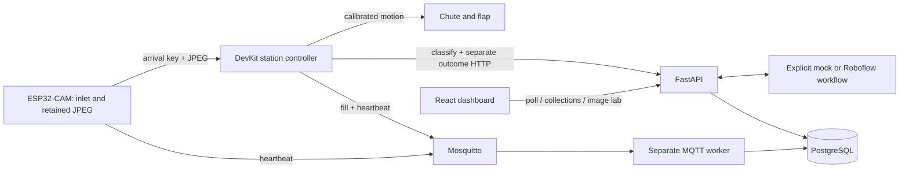

# System architecture

This is a local monitoring and sorting demonstration. The API and MQTT worker share a small Python application and a PostgreSQL database. The frontend polls API data every five seconds. Twelve seeded bins span five floors across Innovation Campus and Central Mall; the seed creates identity/configuration only, not fabricated physical readings.

A prediction and actuation outcome are distinct columns with separate timestamps. Unknown predictions have a reason and cannot be marked completed. Simulator outcomes are labelled simulated. No actuator commands are sent by the server.

Each station has camera/sorter and fill-monitor devices. Status is derived independently from their last timestamp and heartbeat-expiry setting. Offline messages take effect immediately; old messages cannot resurrect a device. A fill message also counts as activity from its sender. Stale compartment measurements remain visible and labelled stale. Invalid/missing current measurements display no percentage rather than 0%.

Telemetry and message IDs persist in SQL; all valid telemetry is retained as history, but only strictly newer timestamps update current readings. A repeated MQTT ID is ignored. QoS 1 subscriptions and a reconnect loop handle broker interruptions; devices/simulators must resend after reconnect. This initial worker uses a clean MQTT session, so disconnected-period messages are not guaranteed unless publishers retry. Single worker deployment is intended. The API never subscribes to MQTT.

Collections record an operator, category, note and UTC timestamp. They do not alter sensor values. The simulator explicitly resets its own generated compartment value when it observes a new collection record. Sensor-only deployments leave measurements unchanged until the device reports again.

Uploads are decoded as JPEG, verified, bounded to 2 MB by default and 20 million pixels, and discarded after classification unless development storage is enabled. The multipart parser may spool input before endpoint validation; the local Nginx proxy imposes a 3 MB total request limit. Do not expose the direct API publicly. API request IDs identify requests; classification request UUIDs identify idempotent events. Matching retries return the same decision; conflicting content with the same event ID receives 409. Concurrent retries may call the inference provider twice, but only one event persists; provider-side billing deduplication is not guaranteed.

SQLite is supported for fast unit tests and a lightweight dashboard demo; Docker Compose uses PostgreSQL. Alembic freezes the initial DDL for both databases. All external timestamp inputs require a timezone, normalize to UTC and reject timestamps over 30 seconds ahead. PostgreSQL stores timezone-aware timestamps; SQLite development serialization restores UTC explicitly.

## Hardware boundary

The camera owns the inlet ultrasonic sensor and JPEG/OTA endpoints. The DevKit
owns both servos and the fill sensor, while also orchestrating camera snapshots,
classification and separate outcome reporting. One compartment is physically
sensed and two remain explicitly simulated. The mechanism has two calibrated
pulse positions; unsupported/Unknown decisions do not actuate.

Only `camera` and `station` PlatformIO environments remain; see the
[firmware guide](../firmware/README.md) for source files and build commands.
Fast drop detection locks on a nearer reading against a configured empty baseline.
The camera retains a delayed fresh exposure and arrival key; the brain consumes
that image once and releases the detector only after outcome acknowledgement.
An exposure predating its scheduled capture time is rejected. Restart journals
prevent automatic movement replay. Calibration/exposure timing require physical
acceptance on the assembled prototype; archived bring-up notes are not evidence
of final imaging accuracy.

The standalone image lab uses `/api/inference/test`, independent of bins and
sorting records. It performs inference only and never commands hardware.

## Future work

Indoor walking graphs/route optimization, fill forecasting, production authentication/roles, TLS/public deployment, hardware sensor calibration, power validation, camera upload reliability and actuator interlocks are future work. No route optimization, forecasting or AI insights are implemented. Add retention/archival policies, durable broker sessions, schema enforcement for authenticated per-device credentials and concurrent outcome conflict handling before production scaling.
