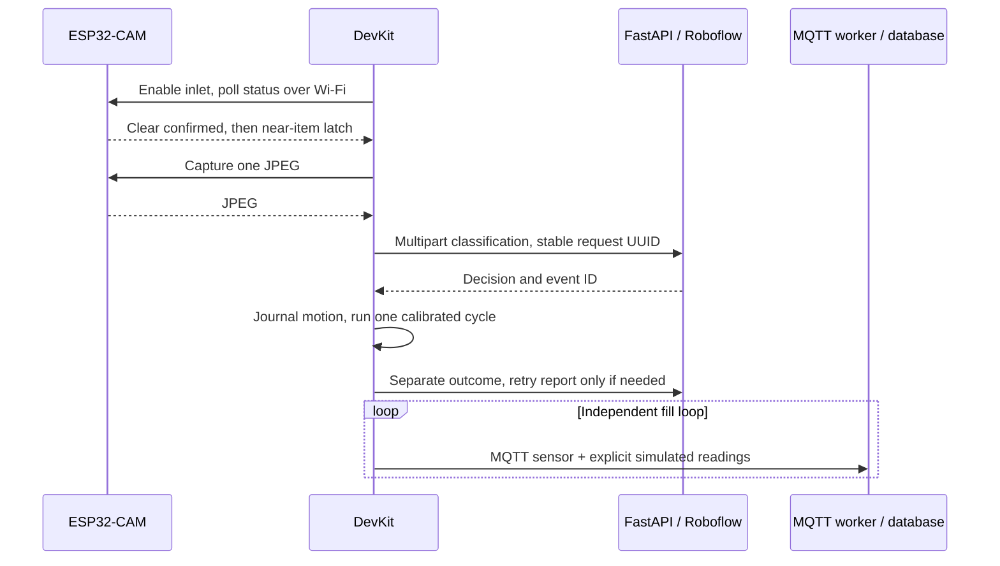

# Combined fill monitor and automatic sorter

> Current source/build entrypoints are documented in the [firmware guide](../firmware/README.md)
> and [scripts guide](../scripts/README.md). This document also preserves chronological
> experiments and superseded commands; older build environments are retired.


The DevKit `station` firmware combines real fill sensing, MQTT telemetry, calibrated servo control, optional receive-only camera serial diagnostics, and automatic sorting over Wi-Fi. The camera runs the current inlet/capture firmware with 8 MHz XCLK. The backend still runs on the local computer; no per-item Python process or USB serial motor bridge is required.

The final powered assembly passed 30/30 camera checks and six decoded JPEG captures. A subsequent three-minute continuous-mode observation completed recyclable and e-waste cycles with no camera outage after readiness. Continuous mode is enabled; clear the inlet before inserting the next item. Detailed evidence and earlier failed comparisons are recorded below.

## Current data flow



The DevKit initiates the camera/backend HTTP flow because the servos are now wired to it. This differs from the original proposed camera-local actuator layout. The camera still provides the inlet sensor and JPEG. HTTP work runs on a separate FreeRTOS task from the fill/MQTT/USB loop, and motor timing runs through the dedicated ESP timer task.

Hardware remains as tested: fill TRIG25/ECHO26, classifier27, opener33, camera inlet TRIG13/ECHO14. The optional camera TX→DevKit RX16 debug signal is currently disconnected. Servo power stays external5V with common ground; the DevKit uses USB power alone while USB is connected. Classifier home/recyclable700us, side/e-waste2000us, opener closed1800us/open700us. Startup closes the flap before homing the classifier; completed sorting cycles hold700/1800us. Non-recyclable/unknown is disabled. One real fill compartment is recyclable; the other two remain explicitly simulated. Empty20cm/full5cm remains temporary, unmeasured bin calibration.

## Build and install

```sh
python3 scripts/configure-station.py
uv tool run --from platformio pio run -d firmware/esp32-monitor -e station -t upload
```

The configuration helper copies the existing private camera control credential into ignored `station.local.h` with mode0600. No Roboflow API key is put on either board. The camera is discovered as `waste-s11-cam.local` over mDNS, with the configured last-known IP as fallback. It must run the current `camera` build; older images need the camera update as well.

Automatic mode is off on a fresh configuration. USB controls are:

```sh
./scripts/station-auto.sh once    # Arm one item; terminal observes status only
./scripts/station-auto.sh on      # Continuous mode, saved across DevKit reboots
./scripts/station-auto.sh status
./scripts/station-auto.sh off     # Disable new arrivals; finish current cycle/report
./scripts/station-auto.sh stop    # Disable auto AND immediately release servo PWM
```

After `on`, close the terminal: the firmware handles future items itself. USB may remain for power/debug; removing the USB bridge does not remove the need for the running local backend or a reliable power supply. Supply the DevKit appropriately if disconnecting USB power. Do not run the old laptop full-sequence bridge or manual servo tests concurrently with armed device control; both the host preflight and device console reject that overlap.

The inlet gate uses the camera firmware's three-sample clear/near latch. It requires an actual clear state before each new arrival and after communication interruptions. Holding an item does not cause repeated paid requests. A camera reboot also invalidates previously observed clear state.

## Outcomes and restart behavior

Each arrival gets one JPEG capture and at most one paid inference request. An ambiguous capture/inference failure disables automatic mode; it does not replay the operation. Before movement, the DevKit persists the event ID and motion phase in NVS. A reboot during that phase never replays motion: it queues a failed outcome and leaves auto disarmed. Completed/disabled/failed outcomes are persisted before reporting; only the idempotent outcome report is retried after an HTTP interruption. New arrivals wait until that report is acknowledged.

Continuous-mode enablement persists. One-shot enablement does not. Status distinguishes active sequence, home holding, automatic mode, controller stage, pending outcome, event ID, decision, camera IP and distance. No physical feedback sensor proves that waste actually reached the compartment.

## Broker recovery and verification

The running broker must contain the board-specific accounts. If they are rejected, run:

```sh
sudo ./scripts/repair-hardware-broker.sh
```

This restores device accounts/ACLs while preserving the inference provider and database. It requires local sudo authentication. The base initializer now preserves complete existing configuration; use the hardware overlays and repair script when provisioning hardware accounts or restoring LAN bindings.

First verify fresh telemetry:

```sh
uv run --directory backend python ../scripts/diagnostics/verify-fill.py --category recyclable
```

Then arm one item with `station-auto.sh once`. Keep the inlet clear until the controller reports `waiting_item` / `ready=True`, then insert an item and keep hands clear. Inspect the backend event and its completed outcome, and confirm fresh physical sensor telemetry overlaps the cycle. An `unknown` decision validates the rejection path and sends no motion. After successful hardware verification, enable persistent mode with `station-auto.sh on`.

Native tests exercise camera latch/reboot/disconnect behavior and the calibrated motor plan. Backend tests verify inference, persistence, MQTT contracts, and that the old laptop bridge cannot compete with enabled automatic device control. Live results are recorded below after execution; compilation alone does not establish hardware success.

## Live validation so far

The combined firmware was USB-flashed with hash verification. The first115200-baud attempt had a serial-stream failure;57600-baud retries completed. A larger combined USB status exposed partial-line reads; status is now emitted as one UART write and the host reader reassembles fragments, with dedicated regression tests.

Both board MQTT accounts were initially rejected. After the user ran the hardware broker repair, both accounts passed authentication. The installed firmware reports `station-controller`, fill25/26 enabled, calibrated home holding700/1800us, automatic support available and automatic mode initially disarmed. Fresh database telemetry passed `verify-fill.py`: recyclable source=sensor/quality=valid, other compartments source=simulated. Further sensor/simulated rows continued every few seconds while camera requests timed out and recovered, confirming that slow camera HTTP does not stop the fill loop. Both board heartbeats are live, and receive-only camera logs are visible again.

`station-auto.sh once` successfully armed the real DevKit and reached `waiting_item`, ready=true, with camera inlet around39–41cm. The USB process is only observing status after that one arm command. At the time of this note, physical item insertion is still awaited, so the combined autonomous capture→classification→motor→outcome path and telemetry overlap with its motor cycle remain pending. Continuous mode has not been enabled yet.

Software verification:54 backend tests passed (one existing dependency deprecation warning), native inlet/arrival-gate/motor-plan tests passed, monitor station/fill/fill-debug/servo targets compile, and camera inlet/servo regression builds passed. No frontend changes were required.

## Completed live checks and continuous enablement

The user's subsequent one-item runs produced real automatic backend events. E-waste event`df10a260-9346-4d42-a7cb-905f23568564` was created`2026-11-02T12:40:48.912734Z` and completed`2026-11-02T12:40:57.268358Z`, providerRoboflow, simulated=false. Later unknown predictions were persisted disabled, showing the rejection path remains active. The historical telemetry API only returns the latest180 rows, so that older event's exact overlap could not be checked retrospectively through the current endpoint.

A separate controlled side cycle verified concurrency directly: start`2026-11-02T12:49:42.859363Z`, finish`2026-11-02T12:49:51.722766Z`. One valid physical sensor reading at`2026-11-02T12:49:46.714419Z` and two explicitly simulated compartment readings were persisted within the cycle window. The controller finished holding classifier700us/opener1800us. This was a mechanical/concurrency check; it did not manufacture a new classification event.

`station-auto.sh on` then acknowledged automatic_enabled=true and automatic_continuous=true. The setting is saved in NVS. Keep the local backend running; future items are handled by firmware rather than the Python USB bridge. Use `station-auto.sh off` to disable new arrivals, or `stop` to release PWM. Bin height calibration and classifier accuracy remain deferred.

The follow-up continuous readiness check did not reach a camera-ready stage within60 seconds. Backend evidence at that point showed DevKit online with fresh valid sensor data (`2026-11-02T12:52:20.031367Z`) but camera offline (last heartbeat`2026-11-02T12:49:51.191637Z`). Continuous mode was saved; camera reconnection remains a live hardware/network dependency. The user was asked to restart the camera. No additional capture or motor command was issued to bypass the offline camera.

### Camera restart follow-up

After the camera restarted, both device heartbeats returned, but the controller was disarmed. Continuous mode was re-enabled; a75-second observation showed Wi-Fi/MQTT connected, automatic_continuous=true, and waiting_camera because camera status was unavailable. No additional movement was forced.

The reconnect guard was adjusted so camera_ready=false or a pending previous camera outcome pauses at waiting_camera without clearing continuous enablement. Competing camera automatic capture/actuator control still disarms the controller. Camera status and sensor-enable HTTP timeouts increased to20 seconds (4-second connect timeout) to accommodate observed slow camera responses. Paid inference/movement retry rules are unchanged.

The20-second reconnect build was flashed with verification. A100-second observation confirmed DevKit Wi-Fi/MQTT connected, continuous mode still armed, and home700/1800us held, but camera status remained unavailable. A fresh host check also timed out against the camera and showed its heartbeat stale while monitor telemetry remained fresh. The camera had returned briefly after the user's reset, then became unreachable again. This is not established as an eight-second timeout issue; the longer timeout/readiness guard remains a conservative reconnect improvement.

Automatic sorting was disarmed for a physical power-isolation check. The user was asked to temporarily remove servo5V power while keeping the camera powered and shared grounds/signals unchanged. Shared-supply loading is a hypothesis, not a confirmed cause. The current diagnostic state is auto off, calibrated holding commands retained; do not claim continuous operation is ready until camera stability is restored.

### Servo-power isolation observation

With both servo red5V leads disconnected and camera external power restored, the camera answered2 of12 HTTP status probes, then timed out on the remaining10. Successful probes showed camera_ready=true at uptimes50874ms and64166ms, RSSI−69/−66, with MQTT connected then disconnected. Later requests included read/connect timeouts. This did not establish a stable camera connection or prove motor loading as the cause; servo signal wires were still connected during this first check.

The receive-only relay capture `.hardware-backups/camera-isolated-power-serial.log` was unreadable and cannot be used as evidence of a particular boot/reset cause. Host UART settings were1152008N1, matching source settings; no root cause was inferred from the corrupted bytes. Automatic mode stayed disarmed and no motor movement or paid inference was requested.

The next requested physical baseline is camera alone on its USB baseboard, all camera jumpers/external5V disconnected, for direct boot logs and a repeat HTTP stability check. This isolates the external camera power/wiring and bypasses the relay. Servo power remains disconnected during diagnosis.

### USB baseline and network recovery

Direct USB serial showed normal power-on, successful OV3660/PSRAM initialization,
then failed network operations while application logs continued, without an observed
reboot. USB-only operation initially answered only 3 of 10 status checks. This does
not establish external power or servo loading as the cause.

The computer had reconnected to `12a02_5G`. Reconnecting its saved
`12a02_2.4G` profile retained backend address `192.168.1.147`. After camera
restart, 29 of 30 status checks succeeded; three separate JPEG requests returned
valid JPEG headers and HTTP 200. Responses still sometimes took several seconds.
The band change and restart occurred in the same diagnostic window, so their
individual effects are not established. Cross-band communication should normally
work on one LAN; do not assume different bands inherently prevent communication.

The backend was also stopped/unready. After service startup it recovered, but
both saved board MQTT accounts were rejected (`Not authorized`, camera return
code 5). The base broker initializer unconditionally replaced hardware accounts
and ACLs with demo accounts whenever it ran. It now preserves existing complete
configuration. The explicit hardware repair still reprovisions the hardware
accounts and updates the stopped initializer container so its old command cannot
overwrite them on the next start:

```sh
sudo ./scripts/repair-hardware-broker.sh
```

Repeat a read-only camera stability check (no inference credits or movement):

```sh
uv run --directory backend python ../scripts/diagnostics/check-camera.py --samples 60
```

This checks MQTT state, camera readiness, monotonically increasing uptime, and
decodes a JPEG every ten samples. Any failed sample makes the check exit nonzero.
Keep automatic mode off and servos unpowered during the isolated check. The
external-power/wiring baseline and final assembled sequence must still be verified
after USB-only operation passes.

The broker repair subsequently passed authentication for both board accounts;
physical sensor telemetry and board heartbeats returned. A raw OS serial reader
was found to leave the USB baseboard's modem-control lines in a reset-triggering
state. Samples collected with that reader are not evidence of a firmware hang.
Serial captures now explicitly release DTR and RTS through pyserial.

With corrected serial control, the temporary network-only firmware acknowledged
MQTT heartbeats and returned 30/30 pings (9.6–139.6 ms). Restoring full camera
firmware at 20 MHz XCLK returned only 4/20 pings (3.2–4.7 seconds), and the first
three soak samples timed out connecting. That soak was stopped for the next
controlled experiment, not counted as a complete 60-sample run. Camera status now
exposes BSSID, Wi-Fi channel, reset reason, largest heap block and XCLK frequency.
The next comparison lowers XCLK to 10 MHz for single-frame capture.

The 10 MHz camera build was USB-flashed with hash verification and passed the
USB-only comparison: 30/30 pings, then 60/60 successful status samples spanning
145.2 seconds of uptime, six fully decoded JPEG captures, MQTT connected in all
samples, and no detected reboot. Median status/capture iteration time was 0.260
seconds; the slowest was 9.473 seconds. Sensor OV3660 and PSRAM initialized
successfully. Hardware camera heartbeats were persisted alongside fresh DevKit
fill telemetry. These results establish a useful improvement on this board;
they do not identify the electrical/driver mechanism or guarantee every network.

Camera XCLK now defaults to 10 MHz and can be overridden with
`CAMERA_XCLK_HZ`. Camera-test, inlet-Roboflow, and camera servo-bench builds
passed; all 54 backend tests passed. The default broker initializer's
preserve-existing-configuration branch was exercised against temporary hardware
credential/ACL/config files and left all three unchanged. Compose validation,
repair script syntax, and diff whitespace checks passed.

Automatic sorting remains off. The user was asked to restore camera external
power, inlet sensor wiring and servo power for the final assembled baseline.
External-power stability and a post-fix physical sorting cycle remain pending;
the USB pass alone does not complete those checks.

### External wiring and post-fix autonomous cycle

The user restored external camera/inlet/servo wiring, with the DevKit on USB.
Initial external-power samples returned camera_ready=true, MQTT connected and
RSSI around -60 to -65 dBm. Later samples had connect/read timeouts, and the
controller observed intermittent waiting_camera recovery. This initial assembled
baseline did not pass; do not describe it as uninterrupted external operation.
The competing host soak was stopped before the item test.

USB identification initially timed out while the DevKit booted. The host helper
now allows 15 seconds instead of 5 for boot, serial framing and startup homing;
its three existing USB framing regression tests passed. No motor command is sent
until the expected combined firmware status is identified.

The controller then armed one item, observed a clear inlet around 57–58 cm,
detected arrival at 7.47 cm and captured a 4698-byte JPEG. Real event
`fcb98aa7-20c5-4369-92e1-4ccc87fb4d18` was classified recyclable at confidence
0.886 by Roboflow at `2026-11-02T14:28:47.942781Z`; completed outcome was persisted
at `2026-11-02T14:28:56.247824Z`, simulated=false. Final controller status verified
classifier700us/opener1800us, home holding, no pending outcome and auto off.
Two valid physical sensor readings and four explicitly simulated compartment
readings were persisted during that event's cycle window. The USB observer sent
one arm command and observed status; firmware performed capture, inference,
movement and reporting. Physical drop/closure confirmation and the post-motor
camera soak remain pending.

The user subsequently confirmed the item dropped into the recyclable
compartment, the flap fully closed and the classifier stayed home. The post-motor
camera soak decoded all four JPEG checks, but one of 20 samples had a connect
timeout. Thus the mechanical cycle passed, while occasional transport stalls
remained; neither initial nor post-motor assembled soak was a zero-failure pass.

To reduce short-lived TCP connection churn, the controller now polls camera
status once per second instead of up to five times per second. The camera's
local clear/near latch still detects arrivals, so this does not require holding
an object through three slow HTTP polls. One additional read-only status attempt
is allowed before declaring camera communication lost. Camera reboot detection,
fresh-clear requirements after a declared outage, and the single capture,
inference and motion rules are unchanged. USB status exposes
`camera_poll_interval_ms=1000` and `camera_status_attempts=2`.

The updated station firmware compiled and the native camera arrival-gate test
and all 54 backend tests passed. Hardware validation of this last transport
adjustment is pending until its upload and live observation complete.

The last station build was USB-flashed with hash verification. Live USB status
confirmed the 1000 ms interval and two status attempts. Continuous mode was
enabled once for observation; DevKit Wi-Fi/MQTT stayed connected and home pulses
remained 700/1800us, but camera readiness did not return during this observation.
Camera heartbeats still arrived intermittently; a host ping sample returned
3/4 packets with 367–1388 ms latency, and a host camera HTTP request timed out.
mDNS and the controller both used the correct camera address 192.168.1.207.
Thus slower polling did not resolve external-power connectivity, and must not
be represented as a proven root-cause fix. The observer was stopped before its
planned 180-second deadline and automatic mode was explicitly disabled and
acknowledged off, idle, with no pending outcome.

Next requested physical comparison: camera remains off its baseboard with its
inlet/debug wiring intact, but receives 5V/common GND via jumpers from labelled
power sockets on the USB-connected empty baseboard. The external supply's
positive lead is removed from the camera; servos retain external power and
DevKit retains USB power. This compares camera power sources while keeping the
mechanism usable. If the baseboard power sockets cannot be identified, do not
guess their positions. This test is pending user wiring confirmation.

The user confirmed USB-baseboard jumper power and pressed camera RST. The camera
did not rejoin the network: all 30 status checks failed and no JPEG was obtained;
192.168.1.207 became an unresolved/failed neighbor, mDNS did not resolve, and its
backend heartbeat remained stale. The DevKit returned to online telemetry.
This is not a valid passing USB-power comparison: the physical power path must
be verified before attributing the result to the camera or supply. The user
reports no camera indicator LED; lack of an LED is not evidence that it lacks
power.

The first DevKit relay capture was unreadable and cannot identify a camera boot
fault. Reopening its port later produced valid 115200-baud controller status,
with auto off. A diagnostic attempt at a nonstandard host baud was rejected by
the USB driver; the port was restored to 115200 and no firmware baud changed.
ModemManager explicitly ignores the CP2102 device in the current udev properties.
Further power rewiring needs a clear view of the baseboard labels and jumper
endpoints rather than assumed socket positions.

The user then identified the initial jumper error: the baseboard 5V wire went
to an empty neighboring position and baseboard GND went to camera5V. They
corrected the power wiring. The camera returned to Wi-Fi and decoded JPEGs,
confirming the earlier 30 failures were not a passing test of a correctly
powered camera. However, the corrected-power check still had 21 failed samples
out of 26 completed samples before it was stopped (including MQTT disconnects
and transport timeouts), with three successful JPEG responses.

Removing only the optional camera TX→DevKit RX16 signal improved the next
comparison: all 20 status requests returned and four JPEGs decoded, but MQTT was
disconnected in three samples. Camera uptime continued through this change, so
no reboot was observed. This does not establish the debug wire as the complete
cause. It remains disconnected while the inlet sensor and corrected USB-jumper
power stay connected; auto remains off.

A closely matching [report in Espressif's Arduino issue tracker](https://github.com/espressif/arduino-esp32/issues/5834)
describes camera/peripheral clock interference at 5/10/20 MHz and improved
Wi-Fi with 8 MHz on tested ESP32-CAM hardware. The report used other sensor
configurations, so its result must be verified with this OV3660. An 8 MHz build
compiled; a single authenticated OTA update was accepted and began transferring.
No live result for the new clock is claimed before upload and capture checks
complete. No additional paid inference or motor command was sent in these
comparisons.

The first 8 MHz OTA attempt authenticated and transferred 295 of 976 chunks,
then failed. It did not establish that the new build was installed. A direct
USB flash was requested after preparing the image; automatic sorting remains
off. The prepared build also deinitializes the camera at authenticated OTA
start, after any active HTTP frame handler has returned. This releases the
camera driver/XCLK while firmware is received. If OTA fails after suspension,
capture remains unavailable with an explicit reset-required error; successful
OTA reboots and initializes the camera normally. This behavior still needs
live verification after USB installation.

The user seated the camera on its USB baseboard. The prepared 8 MHz image was
USB-flashed successfully with hash verification. Runtime status confirmed
8000000 Hz, OV3660 ready and MQTT connected. USB-only checks passed 60/60 status
samples, six decoded JPEG captures and 30/30 pings (7–96 ms). Median combined
status/capture iteration latency was 0.065 seconds, maximum 6.916 seconds. The
camera inlet/Roboflow and servo-bench build variants compiled. A same-image OTA
verification was then started to exercise the new camera-suspension callback;
that transfer and the assembled-wiring comparison are still pending at this
point. The optional debug wire remains disconnected.

The same-image authenticated OTA verification completed successfully. After the
automatic reboot, runtime status again reported 8 MHz, camera ready, MQTT
connected and low uptime; three additional status checks and one decoded JPEG
passed. This verifies the new firmware's update/reboot/capture path. The user
was asked to restore corrected USB-baseboard jumper power, inlet13/14,
DevKit USB and external servo power, leaving the optional debug signal off,
for the assembled comparison. Automatic sorting remains off pending that test.

### Final assembled 8 MHz validation

The first restored-assembly probes occurred while camera power was off. The user
identified a further power-connection mistake, corrected it and powered the
camera. The pre-power probes are not evidence of an 8 MHz firmware failure.
After reachability and readiness returned, a fresh powered-assembly soak passed
30/30 status samples and six decoded JPEG captures, MQTT connected throughout,
median iteration latency 0.055 seconds and maximum 1.953 seconds.

The DevKit USB console needed reopening before status could be read. Continuous
mode was enabled once through `station-auto.sh on`. The read-only observer then
reopened the USB connection and confirmed enablement survived the DevKit restart.
It observed 88 status snapshots over 180.04 seconds, first ready at 12.76 seconds,
zero camera-outage samples after readiness, and zero DevKit Wi-Fi/MQTT faults
after readiness. Camera uptime continued without a detected reboot. The observer
sent only status queries; firmware handled both successful arrivals:

| Real event | Decision/confidence | Created UTC | Completed UTC |
| --- | --- | --- | --- |
| `65eea713-fbb0-4611-9b3e-c83cb36620e1` | recyclable / 0.8183 | 2026-11-02 15:27:51.680574 | 2026-11-02 15:28:00.795726 |
| `c28a72e0-5ee4-4e14-8f24-bf4eb2c60e93` | e_waste / 0.7165 | 2026-11-02 15:28:09.115979 | 2026-11-02 15:28:18.211028 |

Both are provider=roboflow, simulated=false, outcome=completed. Between them the
controller observed the inlet clear at 30.62 cm and rearmed before the second
arrival at 5.53 cm. The user explicitly confirmed the side cycle dropped the
item, closed and returned home. Two valid physical fill readings and four
explicitly simulated readings were persisted during the e-waste cycle window.
Fresh fill verification also passed. An earlier low-confidence recyclable
prediction (`9f885fd4-3bf6-4661-96f2-d8e47a12c138`, confidence0.625) was persisted
unknown/disabled rather than forcing movement.

Final observed state: continuous mode enabled, no busy operation or pending
outcome, no error, classifier700us/opener1800us held, both devices online. The
inlet still read about5.2cm, so the controller correctly waited for clear rather
than repeatedly charging inference for the held obstruction. Clear the inlet
before the next item. Image/classifier tuning, measured bin calibration and a
third physical route remain deferred as agreed; the two-route prototype core
is validated for proceeding to frontend polish and a recorded demonstration.

## Visible controller status and inlet mounting diagnostics

The DevKit user LED defaults to GPIO2 (active high on the DOIT board; clone
layouts can differ). Override `STATION_LED_GPIO` / `STATION_LED_ACTIVE_HIGH`, or
set the GPIO to -1 to disable. The power LED is not software controlled. Status
includes `status_led_gpio`, `status_led_pattern`, controller uptime and the age
of the last camera distance reply. A lost connection invalidates that reading.

| User LED | Meaning |
| --- | --- |
| Off | Automatic sorting disarmed |
| Steady on | Ready for the next item |
| 1 short flash, then pause | Waiting for a clear inlet |
| 2 short flashes, then pause | Wi-Fi disconnected |
| 3 short flashes, then pause | Waiting for camera / enabling inlet |
| Rapid blinking | Capturing or classifying |
| Slow blinking | Sorting cycle in progress |
| 4 short flashes, then pause | Outcome reporting pending |
| 6 short flashes, then pause | Controller error; inspect status |

Counted patterns repeat every three seconds. These are software progress
indications, not feedback proving a flap or chute reached its position.

For read-only mounting checks, disarm sorting and observe distance without
performing inference or starting motors:

```sh
./scripts/station-auto.sh off
uv run --directory backend python ../scripts/diagnostics/watch-inlet.py
# If mDNS fails, supply the current camera address with --host ADDRESS.
```

The current camera detector still requires three valid readings >=16cm to
establish clear, then three readings <=15cm to trigger, with a five-second
cooldown. A missing echo is not treated as clear. Test the empty opening and an
item held in the actual detection path before choosing replacement thresholds.
A horizontal drop-through mounting would need camera-local single-sample
arrival latching and an event counter consumed by the controller; simply
removing debounce does not ensure the one-second HTTP poll sees a brief item.


### Downward-facing mounting adjustment

A later mounted-inlet check found valid empty distances initially18.9cm, then
19.5–25.7cm, and a stationary item at12.9cm (one14.6cm reading). The original
12cm near threshold excluded that item. A subsequent explicitly empty check
stabilized at16.3–16.6cm, below the old18cm clear threshold. Shared `inlet_thresholds.h` now sets
near15cm / clear16cm for both the camera detector and the DevKit arrival gate.
The three-sample debounce and one-item latch remain. Both firmware targets must
receive this update together. Thereafter, camera status supplies the active
thresholds to the DevKit, so mounting calibration no longer requires reflashing:

```sh
./scripts/station-auto.sh off
uv run --directory backend python ../scripts/camera-control.py enable \
  --host waste-s11-cam.local --wiring-confirmed --near-cm 15 --clear-cm 16
```

These runtime values last until camera reboot, which restores defaults15/16.
Changing thresholds resets the detector and requires a fresh empty inlet.
The one-centimeter hysteresis is provisional. Later hands-clear measurements
overlap the empty range, so these values are not accepted for unattended sorting.

Keep sorting disarmed during mounting tests. Moving an item closer by hand
produced5.9–9.5cm readings and correctly latched the detector, but that did not
establish that an item at its normal resting height crossed the old threshold.

The final camera update passed authenticated OTA; the final DevKit USB upload
completed with flash hash verification. USB status confirmed thresholds15/16,
automatic_enabled=false, and GPIO2 pattern `network-2-flashes` during Wi-Fi
startup followed by `off` after connecting. Physical LED visibility has not yet
been confirmed by the user.

A100-reply camera trace after the update showed three transitions from clear to
latched and back to clear. Near readings included4.9–7.8cm; return-to-empty
readings included16.3–17.2cm. No inference or sorting cycle was enabled for this
check. The user subsequently clarified that the4–7cm readings were their hand removing
the item. These transitions establish hand detection, not reliable resting-item
detection or sorting with the new mount. The camera also reported
MQTT return code5 (account rejected); repair broker credentials before the next
full-system acceptance check.


With the user confirming the item resting and hands clear,16 replies ranged
14.2–20.2cm, commonly14.6–15.9cm. The camera reported clear during18.2–20.2cm
excursions, then latched again at14.6cm. Since earlier confirmed empty readings
were16.3–16.6cm, no fixed distance threshold cleanly separates these samples.
Sorting remains disarmed; the current mounting needs improved echo geometry or
a different detection method before repeated automatic cycles are accepted.

## Fast drop-arrival mode

The current `station` controller uses camera-local `drop` detection instead of
requiring a stationary item below an absolute distance threshold. The initial example
empty baseline is10.5cm; a valid reading at8.5cm or nearer triggers immediately.
Calibrate the baseline to the actual empty reading after positioning/home.
Sampling targets60ms intervals. Three readings within1cm of the configured empty
baseline establish readiness; near-item debounce is removed. Invalid echoes
invalidate readiness, and far-wall spikes cannot establish an empty baseline.
This is a configured baseline, not an estimate continually adapted to an item.

At the first nearer reading the camera latches a random arrival key and captures
a fresh JPEG locally. That JPEG remains in its framebuffer until the controller
releases it. `/status` exposes the arrival key, pending/locked state, frame
availability and capture time. `/capture?arrival_id=KEY` returns that exact JPEG;
a stale key or missing frame returns409 rather than taking a later replacement.
Regular preview/manual classification cannot borrow the retained framebuffer.
OTA/disarm releases it before stopping the camera driver.

The DevKit claims each arrival once, uploads the cached image once, runs the
existing calibrated cycle, and confirms its outcome. Only after the outcome is
acknowledged does continuous mode reset the detector and require a fresh empty
baseline. Distance returning to normal during capture, inference or servo motion
cannot unlock it. One-shot mode leaves the camera locked until explicitly
rearmed. Startup, a new arm command and a connection interruption discard old
unclaimed snapshots and establish a fresh capture session. Camera capture or
backend ambiguity disarms the controller rather than retrying paid inference.

Sensor/frame-only check (no inference or motor action):

```sh
./scripts/station-auto.sh off
uv run --directory backend python ../scripts/camera-control.py enable \
  --host waste-s11-cam.local --wiring-confirmed \
  --detection-mode drop --baseline-cm 10.5 --drop-cm 2
uv run --directory backend python ../scripts/diagnostics/watch-inlet.py
```

Keep the inlet empty until clear-ready, then pass/drop one item through the
beam. `DROP LOCKED` must remain after the object leaves. Enabling again releases
the test snapshot and starts a new baseline check. Explicit baseline/drop calibration is stored in camera NVS and survives camera
reboots and controller re-enables. Fresh devices default to10.5/2 until calibrated.
The old `proximity` mode remains available for earlier manual camera tests.

Actual capture latency and whether the saved image contains a briefly falling
item need physical validation; sensor sampling is not a guarantee that an object
will remain in the camera view long enough for an exposure. MQTT/HTTP work shares
the camera loop, so networking delays can also delay an individual sample.

Live drop-mode checks: a camera-local arrival retained a320x240 JPEG (3968bytes).
Two downloads with the same arrival key had identical hashes; a wrong key and a
regular preview while the frame was reserved both returned409. The user confirmed
that the pictured round translucent surface was the test item. A later DevKit
one-shot uploaded another cached4031-byte frame, received Unknown (raw E-Waste,
confidence0.4295) and persisted disabled outcome for event
`8e0ca383-0a8a-45a0-a1d7-dd30199aae54`. No sorting movement followed that rejection.
This confirms the rejection path, not a completed physical sort.

That one-shot also exposed a stale baseline16.9cm after the user removed the test
item: actual empty readings were about11.2cm. Calibration was corrected and saved
to baseline11.2/drop2 (trigger<=9.2cm). A40-reply empty check had no pending arrival,
all40 replies ready, median11.2cm and occasional farther16.6cm echoes. Farther
spikes did not trigger or change the configured baseline.

The user then confirmed an actual insertion in the rearmed one-shot. Arrival3
latched at4.258621cm against baseline11.2cm and retained a4098-byte320x240 JPEG.
The DevKit uploaded that snapshot once under event
`61b17810-afd2-4acc-bb33-3cb5109b1030`. Roboflow returned raw labelRecyclable at
confidence0.5285, below the configured0.65 threshold, so the normalized decision
wasUnknown and the persisted outcome disabled. The one-shot ended off, with
classifier700us/opener1800us commanded and the camera arrival still locked.
This validates fast arrival→snapshot→single inference→rejection reporting, not a
physical sorting cycle for the new drop mode. Classifier accuracy/thresholds were
not changed. The camera image was decoded and inspected; the snapshot remains
available in RAM until disarm, re-enable or reboot.


### Correction: the arrival snapshot missed the black item

The user clarified that the inserted item was black. The cached arrival3 image
showed the empty round tray; a subsequent read-only manual capture showed the
black item resting in its center. Therefore the previous arrival test proved
transport/rejection reporting, not successful imaging of that item. Its low
classification confidence cannot be used as evidence about black-item accuracy.

Drop detection still latches immediately on one nearer reading. Capture is now
scheduled350ms after detection, allowing the object to reach the tray. The camera
rejects any framebuffer whose first-DMA timestamp predates the scheduled instant;
it never substitutes an earlier image. The arrival remains locked while waiting
for the exposure, and the controller only receives a pending event when that
snapshot has finished (or failed). A missing fresh frame causes disarming rather
than a delayed replacement upload.

`capture_delay_ms` is adjustable from0..1500 via authenticated enable and saved
in NVS when explicitly supplied. The default is350ms. Example:

```sh
uv run --directory backend python ../scripts/camera-control.py enable \
  --host waste-s11-cam.local --wiring-confirmed --detection-mode drop \
  --baseline-cm 11.2 --drop-cm 2 --capture-delay-ms 350
```

Status reports trigger time, requested delay, capture-pending state and the
accepted frame timestamp. Timestamp semantics follow the installed Espressif
camera header: time since boot of the first DMA buffer of the frame; see
[Espressif camera framebuffer definition](https://github.com/espressif/esp32-camera/blob/master/driver/include/esp_camera.h).


## Automatic broker preflight when starting a test

`station-auto.sh on`, `station-auto.sh once` and `test-full-sequence.sh` now check
worker, camera and brain MQTT logins before sending an arm/motor command. Healthy
accounts require no Docker access. On failure, the shared
`ensure-hardware-broker.py` runs the existing hardware-broker repair once, then
checks the actual logins again. A failed repair blocks the new arm command.
Saved firmware credentials and broker host must match `.env.hardware` before a
repair may replace the broker accounts. Passwords are not printed or put on the
host command line; probes use unique IDs so they do not kick the boards offline.

Run the normal commands as your regular user. If repair needs Docker privileges,
sudo can prompt in your terminal; no separate repair command or passwordless-sudo
configuration is needed. Noninteractive callers fail promptly if authentication
is unavailable. `off`, `stop`, `status` and help do not run broker repair.

```sh
./scripts/station-auto.sh once
./scripts/station-auto.sh on
# Optional read-only diagnosis:
uv run --directory backend python ../scripts/ensure-hardware-broker.py --check-only
```

This recovery runs when those computer-side commands start. After continuous
mode is enabled, the ESP32 reconnects by itself; it cannot rewrite the computer's
Docker configuration if broker accounts change later. Restarting through `on`
runs preflight again. The ordinary broker initializer already preserves complete
existing account files instead of overwriting them with demo accounts.
